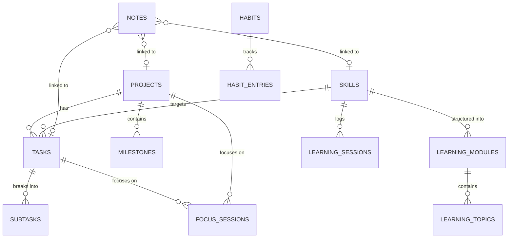

# ProgressOS — Database Schema Specification

ProgressOS uses SQLite managed by Drift (formerly Moor) with strictly typed tables, foreign keys, cascading deletions, and migration management.

---

## 1. Relational Entity Overview

---

## 2. Table Definitions

### 2.1 `tasks` Table
- `id`: Text (UUID Primary Key)
- `title`: Text (Non-null)
- `description`: Text (Nullable)
- `priority`: Text (`low`, `medium`, `high`, `urgent`)
- `due_date`: Integer (Unix timestamp ms, Nullable)
- `has_due_time`: Boolean (Default false)
- `reminder_at`: Integer (Unix timestamp ms, Nullable)
- `project_id`: Text (FK -> `projects.id`, Nullable, ON DELETE SET NULL)
- `skill_id`: Text (FK -> `skills.id`, Nullable, ON DELETE SET NULL)
- `estimated_minutes`: Integer (Default 0)
- `actual_minutes`: Integer (Default 0)
- `recurrence`: Text (`none`, `daily`, `weekly`, `monthly`, `weekdays`)
- `tags`: Text (Comma-separated strings)
- `is_completed`: Boolean (Default false)
- `completed_at`: Integer (Unix timestamp ms, Nullable)
- `created_at`: Integer (Unix timestamp ms)
- `updated_at`: Integer (Unix timestamp ms)

### 2.2 `subtasks` Table
- `id`: Text (UUID PK)
- `task_id`: Text (FK -> `tasks.id`, ON DELETE CASCADE)
- `title`: Text (Non-null)
- `is_completed`: Boolean (Default false)
- `order_index`: Integer (Default 0)
- `created_at`: Integer (Unix timestamp ms)

### 2.3 `projects` Table
- `id`: Text (UUID PK)
- `name`: Text (Non-null)
- `description`: Text (Nullable)
- `category`: Text (e.g. `Startup`, `Web`, `Flutter`, `ML`, `IoT`, `College`, `Open Source`)
- `start_date`: Integer (Unix timestamp ms)
- `target_date`: Integer (Unix timestamp ms, Nullable)
- `status`: Text (`planning`, `active`, `on_hold`, `completed`, `archived`)
- `priority`: Text (`low`, `medium`, `high`, `urgent`)
- `tech_stack`: Text (Comma-separated or JSON list)
- `repository_url`: Text (Nullable)
- `notes`: Text (Nullable)
- `time_spent_minutes`: Integer (Default 0)
- `created_at`: Integer (Unix timestamp ms)
- `updated_at`: Integer (Unix timestamp ms)

### 2.4 `milestones` Table
- `id`: Text (UUID PK)
- `project_id`: Text (FK -> `projects.id`, ON DELETE CASCADE)
- `title`: Text (Non-null)
- `description`: Text (Nullable)
- `target_date`: Integer (Unix timestamp ms, Nullable)
- `is_completed`: Boolean (Default false)
- `completed_at`: Integer (Unix timestamp ms, Nullable)
- `order_index`: Integer (Default 0)

### 2.5 `skills` Table
- `id`: Text (UUID PK)
- `name`: Text (Non-null)
- `category`: Text (e.g. `Language`, `Framework`, `Data/AI`, `Systems`, `Tool`)
- `current_level`: Text (`beginner`, `elementary`, `intermediate`, `advanced`, `expert`)
- `target_level`: Text (`beginner`, `elementary`, `intermediate`, `advanced`, `expert`)
- `notes`: Text (Nullable)
- `learning_minutes`: Integer (Default 0)
- `created_at`: Integer (Unix timestamp ms)
- `updated_at`: Integer (Unix timestamp ms)

### 2.6 `learning_modules` Table
- `id`: Text (UUID PK)
- `skill_id`: Text (FK -> `skills.id`, ON DELETE CASCADE)
- `title`: Text (Non-null)
- `description`: Text (Nullable)
- `order_index`: Integer (Default 0)

### 2.7 `learning_topics` Table
- `id`: Text (UUID PK)
- `module_id`: Text (FK -> `learning_modules.id`, ON DELETE CASCADE)
- `title`: Text (Non-null)
- `status`: Text (`planned`, `in_progress`, `completed`)
- `resources`: Text (JSON string with title & URLs)
- `notes`: Text (Nullable)
- `order_index`: Integer (Default 0)
- `completed_at`: Integer (Unix timestamp ms, Nullable)

### 2.8 `learning_sessions` Table
- `id`: Text (UUID PK)
- `skill_id`: Text (FK -> `skills.id`, ON DELETE CASCADE)
- `topic_id`: Text (FK -> `learning_topics.id`, Nullable, ON DELETE SET NULL)
- `duration_minutes`: Integer (Non-null)
- `notes`: Text (Nullable)
- `created_at`: Integer (Unix timestamp ms)

### 2.9 `goals` Table
- `id`: Text (UUID PK)
- `title`: Text (Non-null)
- `description`: Text (Nullable)
- `type`: Text (`daily`, `weekly`, `monthly`, `long_term`)
- `target_value`: Real (e.g. 45.0 for minutes, 3.0 for problems)
- `current_value`: Real (Default 0.0)
- `unit`: Text (e.g. `mins`, `tasks`, `projects`)
- `deadline`: Integer (Unix timestamp ms, Nullable)
- `is_achieved`: Boolean (Default false)
- `created_at`: Integer (Unix timestamp ms)

### 2.10 `habits` Table
- `id`: Text (UUID PK)
- `title`: Text (Non-null)
- `description`: Text (Nullable)
- `frequency`: Text (`daily`, `weekdays`, `custom`)
- `target_days_per_week`: Integer (Default 7)
- `reminder_time`: Text (e.g. `20:00`, Nullable)
- `created_at`: Integer (Unix timestamp ms)

### 2.11 `habit_entries` Table
- `id`: Text (UUID PK)
- `habit_id`: Text (FK -> `habits.id`, ON DELETE CASCADE)
- `date_str`: Text (e.g. `2026-11-10` for easy date-based querying)
- `is_completed`: Boolean (Default true)
- `notes`: Text (Nullable)
- `created_at`: Integer (Unix timestamp ms)

### 2.12 `focus_sessions` Table
- `id`: Text (UUID PK)
- `task_id`: Text (FK -> `tasks.id`, Nullable, ON DELETE SET NULL)
- `project_id`: Text (FK -> `projects.id`, Nullable, ON DELETE SET NULL)
- `skill_id`: Text (FK -> `skills.id`, Nullable, ON DELETE SET NULL)
- `duration_minutes`: Integer (Non-null)
- `session_type`: Text (`pomodoro`, `short_break`, `long_break`, `custom`)
- `completed_at`: Integer (Unix timestamp ms)

### 2.13 `notes` Table (Knowledge Vault)
- `id`: Text (UUID PK)
- `title`: Text (Non-null)
- `content`: Text (Markdown content)
- `category`: Text (`quick`, `technical`, `idea`, `resource`, `general`)
- `tags`: Text (Comma-separated)
- `project_id`: Text (FK -> `projects.id`, Nullable, ON DELETE SET NULL)
- `skill_id`: Text (FK -> `skills.id`, Nullable, ON DELETE SET NULL)
- `task_id`: Text (FK -> `tasks.id`, Nullable, ON DELETE SET NULL)
- `is_pinned`: Boolean (Default false)
- `created_at`: Integer (Unix timestamp ms)
- `updated_at`: Integer (Unix timestamp ms)

### 2.14 `scheduled_notifications` Table
- `id`: Integer (Auto-increment PK for Notification IDs)
- `task_id`: Text (FK -> `tasks.id`, Nullable, ON DELETE CASCADE)
- `type`: Text (`task_reminder`, `deadline`, `daily_agenda`, `daily_summary`, `habit`)
- `scheduled_time`: Integer (Unix timestamp ms)
- `payload`: Text (JSON string)

### 2.15 `activity_history` Table
- `id`: Text (UUID PK)
- `entity_type`: Text (`task`, `project`, `skill`, `milestone`, `focus`, `habit`)
- `entity_id`: Text (Nullable)
- `action`: Text (`created`, `completed`, `progressed`, `logged`)
- `summary`: Text (Non-null)
- `created_at`: Integer (Unix timestamp ms)

